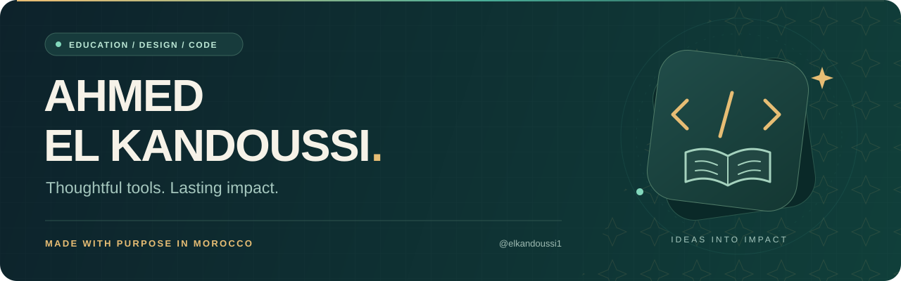
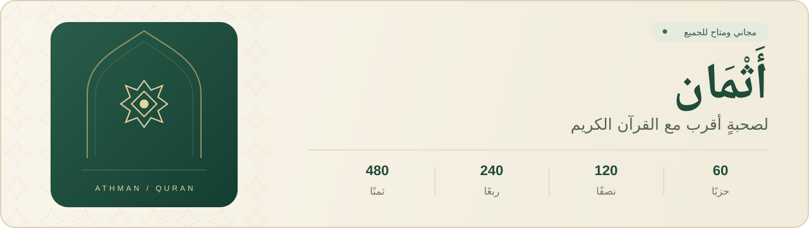
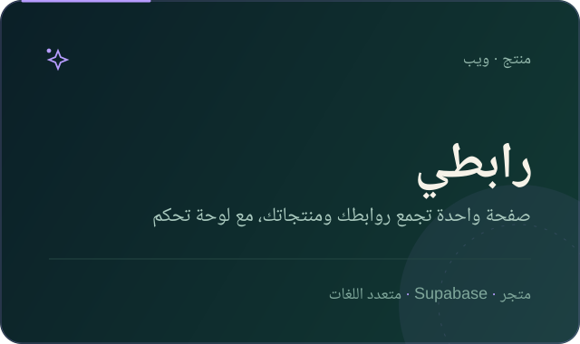
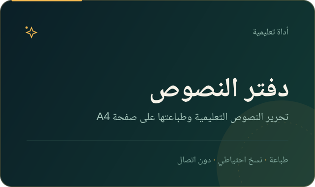
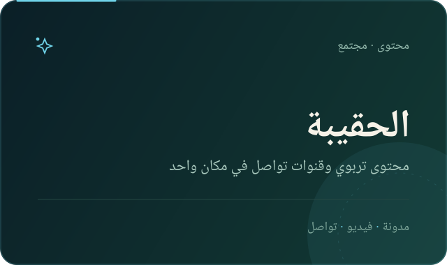
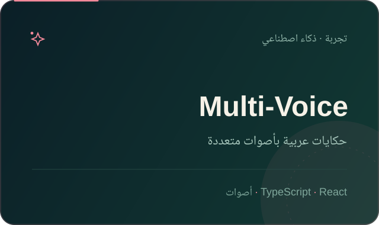
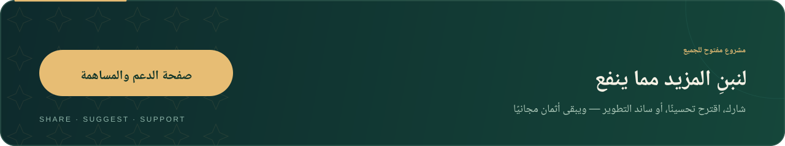

  

  <strong>أدوات عربية تخدم التعليم والقرآن.</strong> 
  أستاذ التربية الإسلامية &nbsp;·&nbsp; مصمم موارد تعليمية &nbsp;·&nbsp; مطوّر ويب

  Building Arabic tools for education, design and the web.

  <a href="https://elkandoussi1.github.io/athman-quran/"><strong>جرّب أثمان</strong> ↗</a>
  &nbsp;·&nbsp;
  <a href="https://github.com/elkandoussi1?tab=repositories">المشاريع</a>
  &nbsp;·&nbsp;
  <a href="https://github.com/elkandoussi1/elkandoussi1/blob/main/SUPPORT.md">الدعم والمساهمة</a>

---

## ✦ الفكرة

أصنع أدوات عربية صغيرة تحلّ حاجة حقيقية: موردٌ يختصر وقت الأستاذ، تطبيقٌ يجعل القرآن أقرب، أو صفحةٌ تجمع ما ينفع. أهتم بالوضوح وسهولة الاستعمال على الهاتف كما على الحاسوب، وأشارك العمل مفتوحًا ليعود النفع على الجميع.

## ✦ المشروع الأحدث · أثمان

  

تطبيق ويب مجاني لتيسير قراءة القرآن الكريم وحفظه ومراجعته **برواية ورش**، وفق التقسيم المغربي للمصحف المحمدي.

- **فهرسة كاملة:** 60 حزبًا · 120 نصفًا · 240 ربعًا · 480 ثمنًا، مع فهرس السور.
- **مراجعة عملية:** بحث يتجاهل التشكيل، إشارات مرجعية، آخر موضع قراءة، ومتابعة المراجعة.
- **تجربة عربية:** واجهة متجاوبة، وضع ليلي، تثبيت على الهاتف، وقراءة دون اتصال بعد أول تنزيل.

[**افتح التطبيق** ↗](https://elkandoussi1.github.io/athman-quran/) &nbsp;·&nbsp; [الكود على GitHub](https://github.com/elkandoussi1/athman-quran) &nbsp;·&nbsp; [ادعم استمراره](https://elkandoussi1.github.io/athman-quran/support.html)

## ✦ من الأعمال

  
  

  
  

**أعمال أقدم:** [AHMED](https://github.com/elkandoussi1/AHMED) — أول واجهة تعريفية لي، من 2024.

## ✦ كيف أعمل

**أولًا · الحاجة قبل الفكرة** — أبدأ من مشكلة حقيقية في الصف أو في الاستعمال اليومي، لا من فكرة مجرّدة.

**ثانيًا · الوضوح قبل الزخرفة** — واجهة عربية تُفهم من أول نظرة، وتعمل على شاشة صغيرة كما على الحاسوب.

**ثالثًا · التجربة قبل النشر** — أستعمل الأداة بنفسي وأرقب ما يتعثّر فيه المستخدم.

**رابعًا · التحسين بعد الملاحظات** — أستمع، وأطوّر بخطوات صغيرة لا تنكسر.

## ✦ ما أستخدمه

  
  
  
  
  
  
  
  
  
  
  
  

## ✦ لنبنِ المزيد مما ينفع

  

مشاركتك للأدوات، وإبلاغك عن خطأ، واقتراحك لتحسين، ومساهمتك بالكود أو التصميم — كلها تُبقي هذا العمل مستمرًا. ولمن رغب واستطاع، تبقى **المساهمة المالية اختيارية**، ويبقى **أثمان مجانيًا للجميع**.

وإن كانت لديك فكرة أداة تخدم أستاذًا أو طالبًا، فاطرحها في [المسائل](https://github.com/elkandoussi1/elkandoussi1/issues) أو راسلني على [تلغرام](https://t.me/elkandoussicom).

**[صفحة الدعم والمساهمة ↗](https://github.com/elkandoussi1/elkandoussi1/blob/main/SUPPORT.md)**

---

  <a href="https://elkandoussi.blogspot.com/?m=1">المدونة</a>
  &nbsp;·&nbsp; <a href="https://www.youtube.com/channel/UC9Vn56jRWt0Zhm2tp4Q2Zug">يوتيوب</a>
  &nbsp;·&nbsp; <a href="https://www.instagram.com/elkandoussicom">إنستغرام</a>
  &nbsp;·&nbsp; <a href="https://www.tiktok.com/@elkandoussicom">تيك توك</a>
  &nbsp;·&nbsp; <a href="https://t.me/elkandoussicom">تلغرام</a>
  &nbsp;·&nbsp; <a href="https://pin.it/6DI0OJQCt">بينترست</a>
  &nbsp;·&nbsp; <a href="https://whatsapp.com/channel/0029Va1DqDJ23n3bLDCNUB1M">واتساب</a>

  أصنع بعناية، وأشارك ما ينفع · Made with purpose in Morocco

