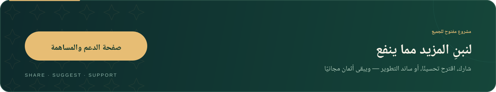

  

<h1 align="center">لنبنِ المزيد مما ينفع</h1>

صفحة الدعم العامة لمشاريع أحمد القندوسي · Ahmed El Kandoussi

أعمل على تحويل الأفكار النافعة إلى أدوات عربية عملية، تجمع التعليم والتصميم والتقنية. هذه مساحة عامة لمن يرغب في تشجيعي على تطوير المزيد من المشاريع المجانية ومفتوحة المصدر، وتحسين تجربة استخدامها وتوثيقها.

**«أثمان» أُعدّ ابتغاء وجه الله تعالى وخدمةً لكتابه الكريم، ويبقى مجانيًا ومتاحًا للجميع. المساندة اختيارية تمامًا.**

## ♡ المساندة المالية الاختيارية

لمن رغب واستطاع، يمكن مساندة المطوّر من خلال صفحة المساندة المنشورة مع «أثمان». يُشجّع هذا الدعم على تخصيص وقت أكبر للتطوير والصيانة، وتحسين الواجهات، وإعداد مشاريع جديدة متاحة للجميع.

هذه المساندة موجّهة إلى المطوّر، ولا يلزم أي مبلغ لاستخدام «أثمان».

### كيف أقدّم المساندة؟

**[افتح صفحة المساندة الاختيارية ↗](https://elkandoussi1.github.io/athman-quran/support.html)**

1. اضغط «مساندة المطوّر اختياريًا» لعرض بيانات المساندة المنشورة هناك.
2. استخدم أزرار النسخ للحصول على البيانات.
3. أتمّ التحويل من تطبيقك البنكي.

## ✦ طرق أخرى تترك أثرًا

- **شارك مشروعًا:** أوصل الأداة إلى أستاذ، أو طالب، أو شخص قد ينتفع بها.
- **أبلغ عن مشكلة:** افتح تذكرة في مستودع المشروع المعني، مع خطوات إعادة المشكلة ووصف السلوك المتوقع.
- **اقترح تحسينًا:** شارك حاجة واقعية أو فكرة تجعل التجربة أوضح وأسهل.
- **ساهم بمهارتك:** تحسين الكود، أو التصميم، أو التوثيق، أو اختبار التطبيق على أجهزة مختلفة.
- **ادعُ بالقبول والنفع:** دعوة طيبة نعتزّ بها.

## ابدأ بمشروع

| المشروع | جرّبه أو استكشفه |
| :--- | :--- |
| **أثمان** | [فتح التطبيق](https://elkandoussi1.github.io/athman-quran/) · [الكود والمساهمة](https://github.com/elkandoussi1/athman-quran) |
| **رابطي** | [فتح التطبيق](https://elkandoussi1.github.io/rabiti/) · [المستودع](https://github.com/elkandoussi1/rabiti) |
| **دفتر النصوص** | [المستودع](https://github.com/elkandoussi1/daftar-nusus) |
| **الحقيبة** | [المستودع](https://github.com/elkandoussi1/elhaqiba) |

جزاكم الله خيرًا على المساندة والمشاركة وطيب الدعاء.

---

  <a href="https://github.com/elkandoussi1">العودة إلى صفحتي الشخصية</a>
  &nbsp; · &nbsp;
  <a href="https://github.com/elkandoussi1?tab=repositories">جميع المشاريع</a>

